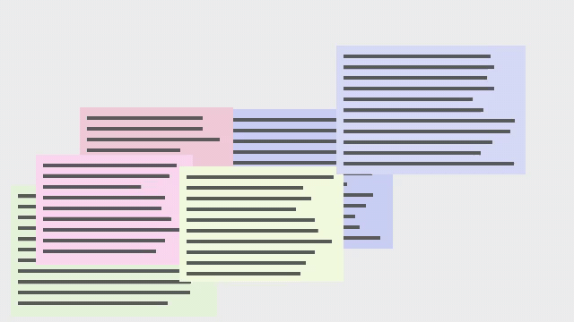
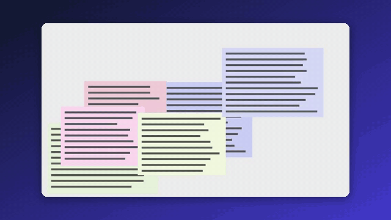

<div align="center">

# screen-polish

**Make a screen recording you already have look produced.** It finds where things happen on screen,
from the pixels alone, zooms in there smoothly, and frames the video on a background with rounded
corners and a shadow. One command; no special recorder, no account, nothing uploaded.

<a href="https://github.com/zch6a/screen-polish/actions/workflows/ci.yml"></a>


<a href="LICENSE"></a>

**English** · [简体中文](README.zh-CN.md)

</div>

---

```bash
uvx --from git+https://github.com/zch6a/screen-polish screen-polish demo.mp4
```

| before | after |
|---|---|
|  |  |

(A synthetic recording, drawn by the tests: typing in a field, a new page, a menu.)

```text
demo.mp4: 640x360, 15 fps, 11.0 s, with audio
  finding where things happen ...
  zoom    2.0-   5.0 s  2.0x on (320, 0) 320x180
  zoom    7.0-   9.5 s  2.0x on (0, 180) 320x180
  wrote demo.polished.mp4 (0.2 MB)
```

## Why another one

Screen Studio, and the open-source apps that follow it (OpenScreen, Recordly, Screenize, ScreenForge
...), zoom where you clicked: they need to make the recording themselves, with a logger that records
your mouse. A recording you already have (from OBS, Teams, Zoom, QuickTime, ShareX, Loom, a phone)
has no clicks in it. screen-polish works from what is in the video: where it changes.

## How it decides where to look

- The video is decoded small (at most 640 px wide) and gray, 8 frames a second, and each frame is
  compared with the one before; changed pixels are pooled into cells, so that compression noise does not count.
- **Not every change means "look here".** A change that goes back to how the screen looked a moment
  ago (a blinking caret, the mouse moving off something, a hover effect) is ignored. Only a change that
  stays (typed text, a menu or dialog that opened, a value that changed) can start a zoom; the mouse
  moving, or resting on something and moving on within 2 seconds, never does, though it can keep a
  zoom going for a few seconds.
- **Typing, a menu, a dialog, a value updating**: the change stays in one area. In sliding windows of
  1.5 seconds, the area where it happens becomes a box, and boxes that stay in the same place for at
  least a second become a zoom: the box with a margin, the video's aspect ratio, at most 2x
  (`--max-zoom`). Typing along a field too wide for one zoom becomes a few, which the camera pans
  through.
- **Scrolling, a new page, switching windows**: much of the screen changes at once. The camera shows
  the whole screen then, so the viewer sees where they are, even between two zooms close in time.
- The camera arrives a little before the activity and leaves a little after; each move eases in and
  out, and zooms in the logarithm of the size, so it feels even. Between zooms close in time it pans
  instead of zooming out and back in.

If you have a click log, `--clicks clicks.json` adds the clicks as activity. Either way, the plan is
yours to change:

```bash
screen-polish demo.mp4 --plan-out plan.json     # the zooms it found: times and rectangles, in pixels
screen-polish demo.mp4 --plan plan.json         # after you edit it: render with those
```

## Use

```bash
screen-polish demo.mp4                          # writes demo.polished.mp4
screen-polish demo.mp4 -o demo.gif              # a GIF, with its own palette
screen-polish demo.mp4 --background ocean       # midnight, ocean, sunset, forest, graphite, paper, or #rrggbb
screen-polish demo.mp4 --padding 4 --radius 2   # % of the width
screen-polish demo.mp4 --no-frame               # just the zooms, edge to edge
screen-polish demo.mp4 --no-zoom                # just the frame
screen-polish demo.mp4 --width 1280 --quality draft
```

The sound is kept (encoded as AAC; silence fills the end if it is shorter than the video). Install the command with `uv tool install git+https://github.com/zch6a/screen-polish`
or `pip install "screen-polish @ git+https://github.com/zch6a/screen-polish"`. It needs Python 3.10+.
The ffmpeg on your PATH is used; without one, the copy that comes with it (the `imageio-ffmpeg` package).

## What it does not do (yet)

- **The cursor stays as it was recorded**: it cannot be removed or smoothed afterwards, since it is part
  of the picture. Recorders that hide it and log it (Screen Studio and the like) can do that.
- **Anything that keeps changing draws the camera**: a video playing in a corner, an animated ad, a
  live chart. When it picks the wrong place, edit the plan.
- No speeding up of idle stretches, no captions, no vertical (9:16) export yet.
- Speed: about real time for 1080p on a laptop (20 s of 1080p30 rendered in 25 s on an i9-12900H).

## Privacy

Everything runs on your computer; nothing is uploaded. screen-polish never records your screen: it
only reads the video file you give it. Its own tests use recordings drawn by a script.

## Status

0.1, in development. Tested on synthetic recordings with a known script (where the zooms must land,
when the whole screen must show, how much a 2x zoom enlarges, that the sound and the length are kept),
on Windows, macOS and Linux in CI.

## Develop

```bash
uv venv && uv pip install -e . pytest ruff
uv run pytest
```

## License

[MIT](LICENSE)
