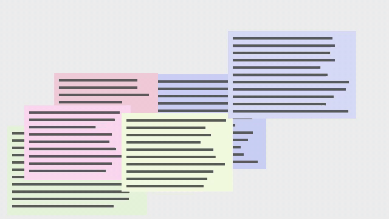
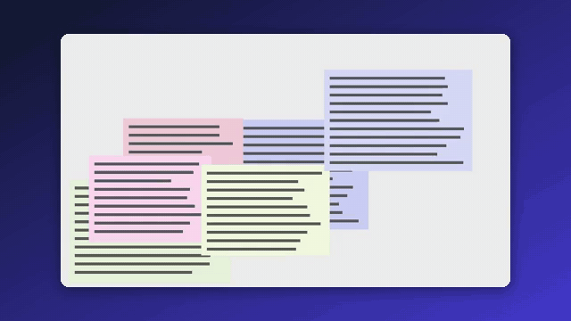

<div align="center">

# screen-polish

**让你已经录好的屏幕录像看起来像精心制作的。** 只看画面本身，找出屏幕上发生事情的地方，平滑地放大过去，再把视频放在带圆角和阴影的背景上。一条命令；不需要专门的录屏软件，不需要账号，不上传任何东西。

<a href="https://github.com/zch6a/screen-polish/actions/workflows/ci.yml"></a>


<a href="LICENSE"></a>

[English](README.md) · **简体中文**

</div>

---

```bash
uvx --from git+https://github.com/zch6a/screen-polish screen-polish demo.mp4
```

| 处理前 | 处理后 |
|---|---|
|  |  |

（一段由测试程序画出来的合成录像：在输入框里打字、换到新页面、打开菜单。）

## 为什么还要做一个

Screen Studio 以及仿照它的开源软件（OpenScreen、Recordly、Screenize、ScreenForge……）都是在你点击的地方放大：录像必须由它们自己录，同时记录你的鼠标。而你已经有的录像（OBS、Teams、Zoom、QuickTime、ShareX、Loom、手机录的）里没有点击信息。screen-polish 只用视频里本来就有的东西：画面哪里在变。

## 它怎么决定看哪里

- 把视频解码成小尺寸（最宽 640 像素）的灰度画面，每秒 8 帧，逐帧和上一帧比较；变化的像素汇总到小格子里，压缩噪点不算数。
- **不是每个变化都值得看。** 变回片刻之前样子的变化（闪烁的输入光标、鼠标移开、悬停效果）会被忽略。只有留下来的变化（打出的字、打开的菜单或对话框、改变的数值）才能触发放大；鼠标移动，或者在某处停留不到 2 秒又移开，都不会触发放大，只能让已有的放大多维持几秒。
- **打字、菜单、对话框、数值更新**：变化集中在一块区域。在 1.5 秒的滑动窗口里，变化发生的区域成为一个框；在同一处持续至少一秒的框成为一次放大：框加上边距，保持视频的宽高比，最多放大 2 倍（`--max-zoom`）。在一个宽到放大后装不下的输入框里打字时，会变成几次放大，镜头依次平移过去。
- **滚动、换页、切换窗口**：屏幕大部分同时变化。这时镜头显示整个屏幕，让观众知道现在在哪，即使两次放大挨得很近也是如此。
- 镜头在动作开始前稍早到达、结束后稍晚离开；每次移动都缓入缓出，按尺寸的对数缩放，所以看起来匀速。两次放大时间很近时，镜头直接平移过去，而不是先缩小再放大。

如果你有点击记录，`--clicks clicks.json` 会把点击也算作动作。无论哪种，放大方案都可以由你修改：

```bash
screen-polish demo.mp4 --plan-out plan.json     # 找到的放大：时间和矩形，单位是像素
screen-polish demo.mp4 --plan plan.json         # 改完之后：按它渲染
```

## 用法

```bash
screen-polish demo.mp4                          # 输出 demo.polished.mp4
screen-polish demo.mp4 -o demo.gif              # 输出 GIF（使用专门生成的调色板）
screen-polish demo.mp4 --background ocean       # midnight、ocean、sunset、forest、graphite、paper，或 #rrggbb
screen-polish demo.mp4 --padding 4 --radius 2   # 占宽度的百分比
screen-polish demo.mp4 --no-frame               # 只要放大，铺满画面
screen-polish demo.mp4 --no-zoom                # 只要背景和边框
screen-polish demo.mp4 --speed-idle 4           # 静止片段（2 秒以上）四倍速播放
screen-polish demo.mp4 --aspect 9:16            # 竖屏，用于 Shorts、Reels、抖音（也可以 1:1、4:5、宽:高）
screen-polish demo.mp4 --width 1280 --quality draft
```

输出是 MP4（H.264；`.mp4`、`.m4v` 或 `.mov`）或 GIF。声音会保留（编码为 AAC；比视频短时，结尾用静音补齐）。使用 `--speed-idle` 时，加速片段的声音也会一起加速（音调不变）：如果你在静止画面上说话，那段话也会变快，所以默认不开。镜头移动始终保持正常速度。加速的片段会写进放大方案（`"speed"`），可以在那里删除或修改。安装成命令：`uv tool install git+https://github.com/zch6a/screen-polish`，或 `pip install "screen-polish @ git+https://github.com/zch6a/screen-polish"`。需要 Python 3.10+。PATH 上有 ffmpeg 就用它；没有的话，用随包一起装上的那份（`imageio-ffmpeg`）；用 `SCREEN_POLISH_FFMPEG=ffmpeg 的路径` 可以另选一个。

## 它（暂时）做不到的

- **鼠标指针保持录制时的样子**：它是画面的一部分，事后去不掉，也没法让它变平滑。能隐藏并记录指针的录屏软件（Screen Studio 之类）才做得到。
- **一直在变的东西会吸引镜头**：角落里在播放的视频、动画广告、实时图表。选错地方时，修改放大方案即可。
- **竖屏视频显示的区域和横屏的放大一样**：整个屏幕放在上下黑边之间；放大时画面占得更满，但上下仍有黑边。要裁得更紧、铺满竖屏，需要知道动作区域本身的大小，暂时还没做。
- 还不能加字幕。
- 速度（i9-12900H 笔记本）：20 秒的 1080p30 用 18 秒；20 秒的 4K30 用 78 秒（加 `--width 1920` 可以输出 1080p）；10 分钟的 1080p30 加 `--speed-idle 4` 用 443 秒。内存：这 10 分钟约 170 MB，4K 约 330 MB。

## 隐私

一切都在你的电脑上运行，不上传任何东西。screen-polish 从不录制你的屏幕：它只读取你给它的视频文件。它自己的测试用的是程序画出来的录像。

## 状态

0.1，开发中。用脚本已知的合成录像测试（放大必须落在哪里、什么时候必须显示整个屏幕、2 倍放大让内容变大多少、声音和画面是否同步，以及输入光标、鼠标、深色主题、4K、手机、15 到 60 fps），CI 在 Windows、macOS 和 Linux 上运行，并由没写过它的人独立审查过两次（[POLISH_LOG.md](POLISH_LOG.md)）。还没有在真实录像上试过。

## 开发

```bash
uv venv && uv pip install -e . pytest ruff
uv run pytest
```

## 许可证

[MIT](LICENSE)
